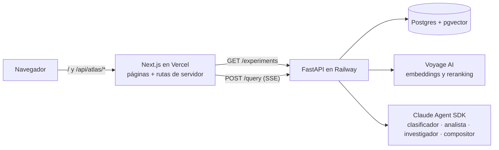

# Atlas del Fuego Lunar

Explorador interactivo de cómo la gravedad, la presión y el oxígeno transforman el fuego. Combina un laboratorio 3D que compara la misma llama en microgravedad, gravedad lunar y terrestre, un mapa de evidencias con los ensayos reales del catálogo **NASA PSI** (Physical Sciences Informatics) y un copiloto de investigación con agentes de IA que responde con datos y citas verificables.

> Proyecto para el NASA Space Apps Challenge 2026. Las llamas del laboratorio son ilustraciones cualitativas, no un simulador predictivo; la evidencia sale de los ensayos registrados.

## Inicio rápido

```bash
pnpm install
cp .env.example .env.local
pnpm dev
```

Abre <http://localhost:3000>. En el modo predeterminado (`ATLAS_DATA_MODE=demo`) el front funciona solo, con datos sintéticos y respuestas guiadas; no requiere backend, base de datos ni claves.

Para usar datos reales de NASA PSI y los agentes, levanta el backend (rama [`backend`](../../tree/backend)) y configura:

```dotenv
ATLAS_DATA_MODE=remote
ATLAS_QUERY_MODE=remote
ATLAS_API_URL=http://127.0.0.1:8000
```

## Ramas del repositorio

| Rama                            | Contenido                             | Despliegue |
| ------------------------------- | ------------------------------------- | ---------- |
| `main`                          | Frontend Next.js (este README)        | Vercel     |
| [`backend`](../../tree/backend) | API FastAPI, datos PSI, RAG y agentes | Railway    |

Front y back viven en ramas separadas del mismo repositorio y se comunican solo por HTTP. El README de la rama `backend` documenta su arranque, endpoints y despliegue.

## Arquitectura



- **El navegador nunca habla con el backend.** Las rutas de servidor de Next.js (`/api/atlas/experiments`, `/api/atlas/query`) actúan como fachada: validan con Zod, traducen el contrato del backend al del front y mantienen `ATLAS_API_URL` y las credenciales fuera del cliente.
- **Respuestas en streaming.** `/api/atlas/query` reenvía los eventos SSE del backend (`status` → progreso, `ui` → bloques) y valida cada bloque por separado; uno inválido se sustituye por un aviso sin perder los demás.
- **Modos de datos.** `demo` usa repositorios en memoria; `remote` usa adaptadores HTTP. El cambio es solo de configuración gracias a los puertos `ExperimentRepository` y `CopilotGateway`.

### Frontend: Clean Architecture por módulos

Cada área del producto vive en `src/modules/<módulo>` con sus capas:

| Capa          | Responsabilidad                                                       |
| ------------- | --------------------------------------------------------------------- |
| `domain`      | Tipos, contratos Zod y reglas puras (sin React ni red)                |
| `application` | Puertos y casos de uso (repositorios, gateways, estado de simulación) |
| `infra`       | Adaptadores: datos demo, cliente HTTP/SSE hacia FastAPI               |
| `ui`          | Componentes React y estilos del módulo                                |

| Módulo       | Qué hace                                                                                                            |
| ------------ | ------------------------------------------------------------------------------------------------------------------- |
| `atlas`      | Catálogo de ensayos, mapa de evidencias O₂ × presión (D3 para escalas, React para el SVG) y estado global del Atlas |
| `simulation` | Laboratorio comparativo 3D: modelo de gravedad, escenarios, reloj de reproducción y shader de llama                 |
| `copilot`    | Contratos de consulta, _evidence brief_, adaptadores demo/remoto y panel del asistente                              |

Fuera de los módulos: `src/app` (rutas y composición), `src/components` (hero, pantalla de carga y transición de entrada) y `src/shared` (configuración y contexto de la experiencia).

### Backend: datos, búsqueda y agentes

1. **Datos.** Tablas experimentales de 13 investigaciones del catálogo NASA PSI, extraídas con Claude a un contrato JSON validado con Pydantic (`data/experiments/` en la rama `backend`) y cargadas en Postgres.
2. **Búsqueda (RAG).** Los documentos se trocean, se vectorizan con Voyage AI (`voyage-4`) y se guardan en pgvector; las consultas se reordenan con el reranker de Voyage.
3. **Agentes.** Un orquestador en Python ejecuta un clasificador, un analista (filtros sobre los ensayos) y un investigador (RAG con citas) en paralelo, y un compositor arma la respuesta. Una capa de anclaje sin LLM descarta cifras, citas o tablas que no aparezcan en los datos registrados.

Detalle completo del flujo en `curren_repo_context/flujo.md` de la rama `backend`.

## Tecnologías

| Área          | Frontend (`main`)                                          | Backend (`backend`)         |
| ------------- | ---------------------------------------------------------- | --------------------------- |
| Lenguaje      | TypeScript 5                                               | Python 3.12                 |
| Framework     | Next.js 16 (App Router), React 19                          | FastAPI, Uvicorn            |
| Visualización | Three.js + React Three Fiber, D3 (escalas), Tailwind CSS 4 | —                           |
| Animación     | GSAP, Motion, Lenis                                        | —                           |
| Validación    | Zod                                                        | Pydantic                    |
| Datos         | —                                                          | PostgreSQL 17 + pgvector    |
| IA            | —                                                          | Claude Agent SDK, Voyage AI |
| Pruebas       | Vitest, Playwright                                         | Pytest                      |
| Despliegue    | Vercel                                                     | Railway (Docker)            |

## Despliegue

### Frontend en Vercel

1. Importa el repositorio en Vercel con la rama `main` como _Production Branch_. Vercel detecta Next.js y pnpm; no hace falta `vercel.json`.
2. Define las variables de entorno (Production y Preview):

   | Variable           | Valor                                                                 |
   | ------------------ | --------------------------------------------------------------------- |
   | `ATLAS_DATA_MODE`  | `remote` (o `demo` para desplegar sin backend)                        |
   | `ATLAS_QUERY_MODE` | `remote` para los agentes, `guided` para respuestas calculadas sin IA |
   | `ATLAS_API_URL`    | Dominio público de Railway, sin `/` final                             |

3. Despliega. `/api/health` responde `{"status":"ok"}` cuando el front está arriba.

La ruta `/api/atlas/query` declara `maxDuration = 150` porque una respuesta de los agentes puede tardar hasta 120 s; el plan de Vercel debe permitir esa duración (con Fluid Compute activo, el límite predeterminado lo cubre).

### Backend en Railway

La rama `backend` incluye `Dockerfile` y `railway.json` (carga de datos antes de cada despliegue y _health check_ en `/health`). Pasos y variables en la sección **Despliegue en Railway** de su README.

## Comandos

| Comando                        | Qué hace                                                               |
| ------------------------------ | ---------------------------------------------------------------------- |
| `pnpm dev`                     | Servidor de desarrollo                                                 |
| `pnpm build` / `pnpm start`    | Build de producción y servidor                                         |
| `pnpm lint` / `pnpm typecheck` | ESLint y TypeScript                                                    |
| `pnpm test`                    | Pruebas unitarias (Vitest)                                             |
| `pnpm test:e2e`                | Pruebas de extremo a extremo (Playwright, usa Edge: `channel: msedge`) |
| `pnpm check`                   | Lint, tipos, pruebas y build; es lo que corre CI                       |

## Estructura

```text
src/
  app/            rutas: página principal, /api/atlas/*, /api/health
  components/     hero, carga y transición de entrada
  modules/        atlas · simulation · copilot (domain/application/infra/ui)
  shared/         configuración y contexto compartido
tests/            Vitest; tests/e2e con Playwright
docs/             contratos y decisiones del frontend
odd/tasks/        bitácora de tareas del desarrollo
theme.md          sistema visual del observatorio
```

## Documentación

- [Frontend: contratos, adaptadores y laboratorio](docs/atlas-frontend.md)
- [Sistema visual](theme.md)
- README de la rama [`backend`](../../tree/backend): endpoints, RAG, agentes y Railway

## Licencia

Código privado; ver [LICENSE](LICENSE).
