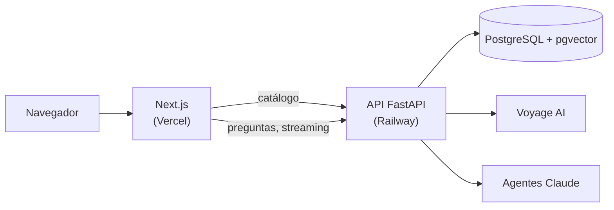

# Atlas del Fuego Lunar

**¿Cómo arde el fuego en la Luna? Nadie lo ha medido todavía.** El Atlas reúne lo que NASA sí sabe sobre combustión fuera de la Tierra, lo vuelve explorable y señala con precisión qué falta por investigar antes de habitar la superficie lunar.

Proyecto para el **NASA Space Apps Challenge 2026**.

## El problema

Un hábitat lunar opera con una atmósfera distinta a la de la Tierra (más oxígeno, menos presión) y con una sexta parte de la gravedad. Las tres variables cambian cómo se enciende, se propaga y se apaga una llama, y por lo tanto el riesgo de incendio.

NASA tiene décadas de experimentos de combustión en el repositorio **Physical Sciences Informatics (PSI)**, pero la evidencia está repartida en tablas, reportes y presentaciones de cada investigación. Para responder una pregunta concreta, como _¿qué materiales se apagaron con 30 % de O₂ a baja presión?_, hay que leer y cruzar varios documentos a mano.

## Nuestra solución

Una sola herramienta con tres piezas que trabajan juntas:

| Pieza                          | Qué permite hacer                                                                                                                                |
| ------------------------------ | ------------------------------------------------------------------------------------------------------------------------------------------------ |
| **Laboratorio comparativo 3D** | Elegir material, oxígeno y presión, y ver la misma llama en microgravedad, gravedad lunar y terrestre, lado a lado.                              |
| **Mapa de evidencias**         | Ubicar cada ensayo real de NASA en el espacio oxígeno × presión, filtrarlo por gravedad y abrir su fuente original.                              |
| **Copiloto de investigación**  | Preguntar en lenguaje natural y recibir un _evidence brief_: veredicto, tabla de ensayos, citas exactas, huecos de evidencia y siguientes pasos. |

### Recorrido de un minuto

1. Entra al laboratorio y sube el oxígeno: la llama cambia de forma en cada gravedad.
2. Pasa al mapa: aparecen los ensayos reales cercanos a esas condiciones, con su resultado (ignición o extinción).
3. Cambia a gravedad lunar: el mapa queda vacío. **Ese hueco es el hallazgo.**
4. Pregunta al copiloto qué se sabe de esas condiciones: responde con datos y citas de NASA y propone qué experimento haría falta.

## Datos de NASA

Usamos **13 investigaciones del repositorio NASA PSI** realizadas en la Estación Espacial Internacional y en naves Cygnus. De sus tablas experimentales salen **1,115 observaciones** (cada una con material, O₂, presión, gravedad y resultado), y de sus reportes, **1,283 fragmentos** de texto para buscar y citar.

| Investigación                | Plataforma                                   | Observaciones |
| ---------------------------- | -------------------------------------------- | ------------: |
| ACME CFI-G (PSI-159)         | ISS, Combustion Integrated Rack              |           326 |
| FLEX (PSI-69)                | ISS, Multi-user Droplet Combustion Apparatus |           274 |
| CFI (PSI-39)                 | ISS, Multi-user Droplet Combustion Apparatus |           227 |
| SAME-R (PSI-101)             | ISS                                          |           109 |
| SAME (PSI-102)               | ISS                                          |            47 |
| ACME BRE (PSI-20)            | ISS, Combustion Integrated Rack              |            43 |
| ACME E-FIELD Flames (PSI-22) | ISS, Combustion Integrated Rack              |            28 |
| BASS-II (PSI-25)             | ISS, Microgravity Science Glovebox           |            26 |
| BASS (PSI-26)                | ISS, Microgravity Science Glovebox           |            14 |
| SAFFIRE-II (PSI-99)          | Nave Cygnus                                  |             9 |
| FLEX-2 (PSI-68)              | ISS, Multi-user Droplet Combustion Apparatus |             8 |
| SAFFIRE-III (PSI-100)        | Nave Cygnus                                  |             2 |
| SAFFIRE-I (PSI-98)           | Nave Cygnus                                  |             2 |

_Fuente: [NASA PSI](https://psi.nasa.gov/physci/repo/). Los conteos salen de `data/experiments/` y el de fragmentos de la indexación (`atlas-index`), ambos en la rama [`backend`](../../tree/backend). Las tablas originales se conservan sin cambios en `data/raw/`._

### El hallazgo: un hueco de evidencia lunar

**Las 1,115 observaciones son en microgravedad; ninguna en gravedad lunar.** El Atlas compara la evidencia con condiciones de referencia de misión, cada una con su fuente (atmósfera de exploración de NASA para hábitats lunares y marcianos, traje EVA lunar y cabina de la ISS), y marca dónde no hay ensayos. Para un hábitat lunar no faltan datos de oxígeno y presión: falta medir el efecto de la gravedad parcial.

## Cómo usamos la IA

| Etapa      | Herramienta                          | Para qué                                                                                                                                         |
| ---------- | ------------------------------------ | ------------------------------------------------------------------------------------------------------------------------------------------------ |
| Extracción | Claude                               | Pasar las tablas y reportes de PSI a un formato común, validado con Pydantic y revisado por el equipo.                                           |
| Búsqueda   | Voyage AI (`voyage-4`, `rerank-2.5`) | Vectorizar los fragmentos de los reportes y ordenar los resultados por relevancia.                                                               |
| Respuestas | Sistema multiagente con Claude       | Un clasificador entiende la pregunta; un analista filtra los ensayos y un investigador busca citas en paralelo; un compositor arma la respuesta. |

**Los números no los inventa la IA.** Los filtros y cálculos se hacen en Python sobre los datos de NASA, y una capa de verificación sin IA compara cada cifra, tabla y cita de la respuesta contra lo que realmente devolvieron las consultas. Lo que no coincide se descarta. Si los agentes fallan, la respuesta se arma con reglas fijas.

## Rigor científico

- **El laboratorio ilustra, no predice.** Las llamas muestran tendencias cualitativas de la física (difusión en microgravedad, convección con gravedad); no son un modelo de combustión validado, y la interfaz las marca como ilustrativas.
- **Toda evidencia es trazable.** Cada punto del mapa y cada cita lleva a la investigación, el archivo y la sección de origen en PSI.
- **Sin datos alterados.** Los ensayos fuera del rango visible del mapa (0–16 psi, 18–50 % O₂) se omiten en lugar de moverse al borde, y la API reporta cuántos quedaron fuera.
- **Los datos de demostración se distinguen.** El modo sin backend usa ensayos sintéticos marcados como tales.

## Arquitectura



- El navegador solo habla con Next.js; las rutas de servidor consultan la API, validan cada respuesta y mantienen las credenciales fuera del cliente.
- Las respuestas del copiloto llegan en streaming (SSE): se ve el progreso de cada agente mientras trabaja.
- Ambos lados siguen Clean Architecture por módulos (dominio, aplicación, infraestructura e interfaz), lo que permite cambiar entre datos de demostración y datos reales solo con configuración.

| Área          | Frontend                                      | Backend                                                      |
| ------------- | --------------------------------------------- | ------------------------------------------------------------ |
| Lenguaje      | TypeScript                                    | Python 3.12                                                  |
| Framework     | Next.js 16, React 19                          | FastAPI                                                      |
| Visualización | Three.js, React Three Fiber, D3, Tailwind CSS | —                                                            |
| Animación     | GSAP, Motion, Lenis                           | —                                                            |
| Datos e IA    | Zod                                           | PostgreSQL + pgvector, Pydantic, Claude Agent SDK, Voyage AI |
| Pruebas       | Vitest, Playwright                            | Pytest                                                       |

## Probarlo localmente

```bash
pnpm install
cp .env.example .env.local
pnpm dev
```

Abre <http://localhost:3000>. Por defecto funciona sin backend, con datos de demostración. Para usar los datos reales de NASA y los agentes, sigue la [guía de despliegue](docs/deploy.md).

## Repositorio

| Rama                            | Contenido                                  |
| ------------------------------- | ------------------------------------------ |
| `main`                          | Frontend: laboratorio, mapa y copiloto     |
| [`backend`](../../tree/backend) | API, datos de NASA PSI, búsqueda y agentes |

Documentación técnica:

- [Despliegue (Vercel y Railway)](docs/deploy.md)
- [Contratos y arquitectura del frontend](docs/atlas-frontend.md)
- [Sistema visual](theme.md)

## Licencia

Código privado; ver [LICENSE](LICENSE).
