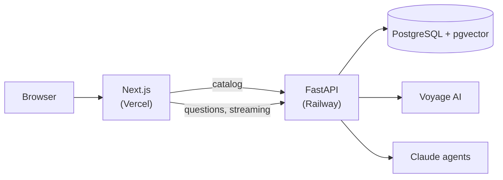

# Lunar Fire Atlas (Atlas del Fuego Lunar)

**How does fire burn on the Moon? Nobody has measured it yet.** The Atlas gathers what NASA does know about combustion beyond Earth, makes it explorable, and pinpoints what still needs to be studied before we live on the lunar surface.

A project for the **NASA Space Apps Challenge 2026**. The interface is in Spanish.

## The problem

A lunar habitat runs on an atmosphere unlike Earth's (more oxygen, lower pressure) under one sixth of Earth's gravity. All three variables change how a flame ignites, spreads and goes out, and therefore the fire risk.

NASA holds decades of combustion experiments in its **Physical Sciences Informatics (PSI)** repository, but the evidence is scattered across the tables, reports and slides of each investigation. Answering a concrete question, such as _which materials went out at 30% O₂ and low pressure?_, means reading and cross-checking several documents by hand.

## Our solution

One tool with three pieces that work together:

| Piece                         | What it lets you do                                                                                                           |
| ----------------------------- | ----------------------------------------------------------------------------------------------------------------------------- |
| **3D comparative laboratory** | Pick a material, oxygen and pressure, and watch the same flame in microgravity, lunar gravity and Earth gravity side by side. |
| **Evidence map**              | Place every real NASA trial in the oxygen × pressure space, filter it by gravity and open its original source.                |
| **Research copilot**          | Ask in natural language and get an _evidence brief_: verdict, trial table, exact citations, evidence gaps and next steps.     |

### One-minute walkthrough

1. Open the laboratory and raise the oxygen: the flame changes shape in each gravity.
2. Switch to the map: the real trials near those conditions appear, with their outcome (ignition or extinction).
3. Switch to lunar gravity: the map is empty. **That gap is the finding.**
4. Ask the copilot what is known about those conditions: it answers with NASA data and citations and proposes the experiment that is missing.

## NASA data

We use **13 investigations from the NASA PSI repository**, flown on the International Space Station and on Cygnus spacecraft. Their experimental tables yield **1,115 observations** (each with material, O₂, pressure, gravity and outcome), and their reports yield **1,283 text chunks** to search and cite.

| Investigation                | Platform                                     | Observations |
| ---------------------------- | -------------------------------------------- | -----------: |
| ACME CFI-G (PSI-159)         | ISS, Combustion Integrated Rack              |          326 |
| FLEX (PSI-69)                | ISS, Multi-user Droplet Combustion Apparatus |          274 |
| CFI (PSI-39)                 | ISS, Multi-user Droplet Combustion Apparatus |          227 |
| SAME-R (PSI-101)             | ISS                                          |          109 |
| SAME (PSI-102)               | ISS                                          |           47 |
| ACME BRE (PSI-20)            | ISS, Combustion Integrated Rack              |           43 |
| ACME E-FIELD Flames (PSI-22) | ISS, Combustion Integrated Rack              |           28 |
| BASS-II (PSI-25)             | ISS, Microgravity Science Glovebox           |           26 |
| BASS (PSI-26)                | ISS, Microgravity Science Glovebox           |           14 |
| SAFFIRE-II (PSI-99)          | Cygnus spacecraft                            |            9 |
| FLEX-2 (PSI-68)              | ISS, Multi-user Droplet Combustion Apparatus |            8 |
| SAFFIRE-III (PSI-100)        | Cygnus spacecraft                            |            2 |
| SAFFIRE-I (PSI-98)           | Cygnus spacecraft                            |            2 |

_Source: [NASA PSI](https://psi.nasa.gov/physci/repo/). Counts come from `data/experiments/` and the chunk count from indexing (`atlas-index`), both on the [`backend`](../../tree/backend) branch. The original tables are kept unchanged in `data/raw/`._

### The finding: a lunar evidence gap

**All 1,115 observations were made in microgravity; none in lunar gravity.** The Atlas compares the evidence with mission reference conditions, each with its own source (NASA's exploration atmosphere for lunar and Martian habitats, the lunar EVA suit and the ISS cabin), and marks where there are no trials. For a lunar habitat, oxygen and pressure data are not what is missing: the effect of partial gravity has yet to be measured.

## How we use AI

| Stage      | Tool                                 | Purpose                                                                                                                                             |
| ---------- | ------------------------------------ | --------------------------------------------------------------------------------------------------------------------------------------------------- |
| Extraction | Claude                               | Turn PSI tables and reports into a common format, validated with Pydantic and reviewed by the team.                                                 |
| Search     | Voyage AI (`voyage-4`, `rerank-2.5`) | Embed the report chunks and rank results by relevance.                                                                                              |
| Answers    | Multi-agent system with Claude       | A classifier reads the question; an analyst filters the trials while a researcher looks for citations in parallel; a composer assembles the answer. |

**The AI does not make up the numbers.** Filters and calculations run in Python over NASA's data, and a verification layer with no AI checks every figure, table and citation in the answer against what the queries actually returned. Anything that does not match is dropped. If the agents fail, the answer is built from fixed rules.

## Scientific rigor

- **The laboratory illustrates; it does not predict.** The flames show qualitative physical trends (diffusion in microgravity, convection under gravity); they are not a validated combustion model, and the interface labels them as illustrative.
- **All evidence is traceable.** Every map point and citation links to its source investigation, file and section in PSI.
- **No altered data.** Trials outside the map's visible range (0–16 psi, 18–50% O₂) are left out rather than clamped to the edge, and the API reports how many were left out.
- **Demo data is labeled.** The no-backend mode uses synthetic trials marked as such.

## Architecture



- The browser only talks to Next.js; its server routes call the API, validate every response and keep credentials out of the client.
- Copilot answers stream over SSE, so you can watch each agent's progress as it works.
- Both sides follow a modular Clean Architecture (domain, application, infrastructure and interface), so switching between demo data and real data is just configuration.

| Area          | Frontend                                      | Backend                                                      |
| ------------- | --------------------------------------------- | ------------------------------------------------------------ |
| Language      | TypeScript                                    | Python 3.12                                                  |
| Framework     | Next.js 16, React 19                          | FastAPI                                                      |
| Visualization | Three.js, React Three Fiber, D3, Tailwind CSS | —                                                            |
| Animation     | GSAP, Motion, Lenis                           | —                                                            |
| Data and AI   | Zod                                           | PostgreSQL + pgvector, Pydantic, Claude Agent SDK, Voyage AI |
| Testing       | Vitest, Playwright                            | Pytest                                                       |

## Run it locally

```bash
pnpm install
cp .env.example .env.local
pnpm dev
```

Open <http://localhost:3000>. By default it runs without a backend, on demo data. To use real NASA data and the agents, follow the [deployment guide](docs/deploy.md).

## Repository

| Branch                          | Contents                              |
| ------------------------------- | ------------------------------------- |
| `main`                          | Frontend: laboratory, map and copilot |
| [`backend`](../../tree/backend) | API, NASA PSI data, search and agents |

Technical documentation:

- [Deployment (Vercel and Railway)](docs/deploy.md)
- [Frontend contracts and architecture](docs/atlas-frontend.md) (Spanish)
- [Visual system](theme.md)

## License

Private code; see [LICENSE](LICENSE).
